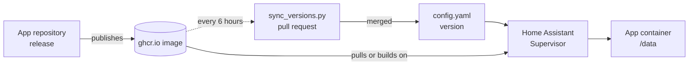

<div align="center">

<picture>
  <source media="(prefers-color-scheme: dark)" srcset=".github/assets/helmerznl.png">
  
</picture>

# Home Assistant Add-On Repository by Helmer

**The self-hosted apps of helmerzNL and Flux76, installed and updated from Home Assistant.**

Home Assistant apps (add-ons) for DiscVault, 3D Print Pricing, MealieShopper and Doorbell Map, each in a stable and a beta version. Every app runs the same published image as the Docker version.

🇬🇧 **English** · 🇳🇱 [Nederlands](README.nl.md)

[](#getting-started)
[](#the-apps)
[](#features)

[](https://github.com/helmerzNL/home-assistant-addons/commits/main)
[](https://github.com/helmerzNL/home-assistant-addons/graphs/commit-activity)
[](https://github.com/helmerzNL/home-assistant-addons/forks)
[](https://github.com/helmerzNL/home-assistant-addons/stargazers)
[](https://github.com/helmerzNL/home-assistant-addons/issues)
[](https://github.com/helmerzNL/home-assistant-addons/graphs/contributors)

[](https://buymeacoffee.com/flux76)
[](https://ko-fi.com/flux76)

[](https://my.home-assistant.io/redirect/supervisor_add_addon_repository/?repository_url=https%3A%2F%2Fgithub.com%2FhelmerzNL%2Fhome-assistant-addons)

[Documentation per app](#the-apps) · [Unraid version](https://github.com/helmerzNL/unraid-community-apps) · [Report a bug](https://github.com/helmerzNL/home-assistant-addons/issues/new/choose)

<table>
  <tr>
    <td align="center" valign="top" width="25%"><a href="https://github.com/helmerzNL/DiscVault"><br><b>DiscVault</b></a><br><sub>4K UHD, Blu-ray and DVD collection</sub></td>
    <td align="center" valign="top" width="25%"><a href="https://github.com/Flux76HQ/3dprint_pricing"><br><b>3D Print Pricing</b></a><br><sub>Cost price and inventory for 3D printing</sub></td>
    <td align="center" valign="top" width="25%"><a href="https://github.com/helmerzNL/MealieShopper"><br><b>MealieShopper</b></a><br><sub>Week menu to supermarket basket</sub></td>
    <td align="center" valign="top" width="25%"><a href="https://github.com/helmerzNL/Doorbell-Map"><br><b>Doorbell Map</b></a><br><sub>Neighbourhood map for door-to-door events</sub></td>
  </tr>
</table>

</div>

---

## Contents

- [Why Home Assistant Add-On Repository by Helmer?](#why-home-assistant-add-on-repository-by-helmer)
- [Features](#features)
- [The apps](#the-apps)
- [Getting started](#getting-started)
- [Configuration](#configuration)
- [Running it](#running-it)
- [Data and backups](#data-and-backups)
- [Architecture](#architecture)
- [Stable and beta](#stable-and-beta)
- [Contributing](#contributing)
- [Privacy and security](#privacy-and-security)
- [Support Home Assistant Add-On Repository by Helmer](#support-home-assistant-add-on-repository-by-helmer)
- [License](#license)

## Why Home Assistant Add-On Repository by Helmer?

Every one of these apps ships a Docker Compose file, but if your server is Home Assistant you would rather not run Docker next to it. This
repository makes each of them a Home Assistant app: installed from the app store, set up on the *Configuration* tab instead of in an `.env`
file, included in Home Assistant's backups, and updated as soon as a new release of the app has a published image. Every app also has a beta
with its own data and port, so you can try what is coming without touching your stable installation.

## Features

- **Four apps in one repository**: DiscVault, 3D Print Pricing, MealieShopper and Doorbell Map, added to Home Assistant with one button.
- **The same app as the Docker version**: every app runs the image the app itself publishes; DiscVault brings its own PostgreSQL in the same
  container, so nothing else has to be installed.
- **Stable and beta side by side**: every beta has its own data folder and port, so both run at the same time.
- **Updates as soon as the image exists**: a check every 6 hours raises an app's version only once the image of the new release is published, so
  Home Assistant never offers an update it cannot install.
- **In your Home Assistant backups**: each app's data is in its own folder, which Home Assistant backs up and restores with the app.
- **Settings in English and Dutch**: every option on the *Configuration* tab is explained in both languages, and every app has a quick start
  and a *Documentation* tab.
- **amd64 and aarch64**: every app runs on both.
- **Your data, your server**: everything runs on your own Home Assistant, and each app's data stays in its own folder there.

## The apps

| App | What it does | Port | Database |
|---|---|---|---|
| [**DiscVault**](discvault/DOCS.md) | Manager for your 4K UHD, Blu-ray and DVD collection | 6180 | PostgreSQL, built in |
| [**DiscVault (beta)**](discvault-beta/DOCS.md) | The development version, next to the stable one | 6181 | PostgreSQL, built in |
| [**MealieShopper**](mealieshopper/DOCS.md) | Week menu from Mealie to your supermarket basket | 5959 | SQLite |
| [**MealieShopper (beta)**](mealieshopper-beta/DOCS.md) | The development version, next to the stable one | 5960 | SQLite |
| [**3D Print Pricing**](printpricing/DOCS.md) | Cost price calculator and inventory for a 3D-print business | 6080 | SQLite |
| [**3D Print Pricing (beta)**](printpricing-beta/DOCS.md) | The development version, next to the stable one | 6081 | SQLite |
| [**Doorbell Map**](doorbell-map/DOCS.md) | Neighbourhood map of houses that do or do not want a visit | 9888 | files |
| [**Doorbell Map (beta)**](doorbell-map-beta/DOCS.md) | The development version, next to the stable one | 9889 | files |

Every app runs on amd64 and aarch64. The name links to the app's documentation, which Home Assistant also shows on its *Documentation* tab;
what changed per version is in the `CHANGELOG.md` next to it.

## Getting started

### Adding the repository

1. In Home Assistant open **Settings > Apps > Install app** (older versions: **Settings > Add-ons > Add-on store**).
2. Open the menu (⋮) > **Repositories** and add `https://github.com/helmerzNL/home-assistant-addons` (or press the button at the top).
3. Pick an app from [the list](#the-apps), **Install** it, and read its **Documentation** tab. Each app also has a quick start on its first page.

### First start

- **DiscVault**: on the *Configuration* tab fill in **rp_id** (the domain you will open DiscVault on) or turn on **password_login**. The first
  start takes a minute; open `https://<your domain>`, or `http://<ip>:6180` with password login, and go through the onboarding.
- **3D Print Pricing**: optionally fill in **rp_id** first. Start the app, read the setup code in the *Log* tab, open the app and go through
  the onboarding: setup code, your name, a passkey or a password, and the recovery codes.
- **MealieShopper**: start the app and open `http://<address of Home Assistant>:5959` (or *Open web UI*); the setup guide takes you through
  security and the links with Mealie and your supermarkets.
- **Doorbell Map**: fill in **origin** (the https address you will open the map on), start the app, read the setup code in the *Log* tab,
  then open the origin address followed by `/beheer`, enter the setup code and create your passkey.

DiscVault, 3D Print Pricing and Doorbell Map sign in with **passkeys**, which only work on an **https** address with a domain name: put a
reverse proxy with a certificate in front of them. 3D Print Pricing, Doorbell Map and (with the `password_login` option) DiscVault also accept a
password on a plain local address. The documentation of each app explains what to enter.

## Configuration

Everything is set on the app's *Configuration* tab; each option is explained there and on the *Documentation* tab. The secrets that the
`.env` of the Docker version would hold are made on the first start and kept in the app's data folder, so you do not have to invent them.

| App | Options |
|---|---|
| DiscVault | Passkeys: `rp_id` (required unless `password_login` is on; changing it later makes existing passkeys unusable), `rp_origins`, `rp_name`. Password sign-in: `password_login`. OpenID Connect: `oidc_issuer`, `oidc_client_id`, `oidc_client_secret`, `oidc_provider_name`, `oidc_insecure_backchannel_origins`. Also `trusted_proxies`, `omdb_api_key`, `tmdb_api_key` and `block_crawlers` (on by default) |
| 3D Print Pricing | Passkeys: `rp_id`, `rp_origins`. Also `setup_code`, `proxy_hops`, `max_upload_mb`, `ai_images_enabled`, `spoolman_url` and `update_check` |
| MealieShopper | All optional, and a link made in the app takes precedence: `mealie_url`, `mealie_api_token`, `public_base_url`, `auth_secret`, `anthropic_api_key`, `openai_api_key`, `picnic_country_code`, `offers_schedule`, `offers_sync_hour`, `mcp`, `update_check`, `audit_log`, `audit_retention_days`, and for passkeys `rp_id`, `rp_origins`, `rp_name` |
| Doorbell Map | `origin` (required), `rp_id`, `site_title`, `setup_token`, `session_hours` |

## Running it

| Task | How |
|---|---|
| Start, stop, restart | The app's page in Home Assistant |
| Update | Home Assistant offers it on the app's page and under *Updates*; let it make a backup of the app first |
| Roll back | Restore the backup of the app from before the update (**Settings > System > Backups**) |
| Logs | The app's *Log* tab |

- **Health check:** with *Watchdog* on, the Supervisor restarts an app that stops answering on its health address: `/api/next/health` for
  DiscVault, `/healthz` for 3D Print Pricing and MealieShopper, `/api/auth/status` for Doorbell Map.
- **Largest upload:** 3D Print Pricing accepts STL and 3MF files up to `max_upload_mb` (50 MB by default, at most 500). Whatever runs in front
  of an app (a reverse proxy, a CDN) must allow at least that much. The other apps state their limits in their own documentation.
- **Update check:** 3D Print Pricing and MealieShopper can also tell the owner in the app when a newer release exists (`update_check`); they
  never update themselves.

Some releases change the database, so take that backup: a release that changed the database may not run on an older version.

### How updates work

An update shows up in Home Assistant when `version` in an add-on's `config.yaml` changes. `scripts/sync_versions.py` compares that version
with the newest release of each app and **only raises it once the image of that release is published**. Every 6 hours a scheduled Claude Code
task runs it on `main` and opens, or updates, one pull request from the branch `automation/update-versions` (the *Update add-on versions*
workflow does the same by hand). Merge it and Home Assistant offers the update. `sources.json` says which repository,
tag pattern and image belong to which add-on.

Until 3 November 2026 the default branch of this repository was `claude/tender-carson-9j0bgt`. Home Assistant keeps reading the branch that
was the default when the repository was added, and it cannot remove the repository while apps from it are installed. So the *Keep the old default
branch in step* workflow moves that branch to `main` after every merge, and an installation from before the switch gets the same updates.

## Data and backups

The data folder of an app (`/data` inside it) holds everything:

| App | What is in it |
|---|---|
| DiscVault | `postgres` (the database), `posters`, `profiles` and `backups`, and the generated secrets in `secrets.json` |
| 3D Print Pricing | `db` (the database, one SQLite file), `uploads` (the STL and 3MF files) and the generated secrets in `secrets.json`. An earlier release's PostgreSQL data in `postgres` is only read once |
| MealieShopper | The database `auth.sqlite3` and `secret.key` |
| Doorbell Map | The houses, passkeys, settings and the app's automatic backups, and the generated secrets in `secrets.json` |

Home Assistant includes that folder in every backup of the app. DiscVault, 3D Print Pricing and Doorbell Map are stopped for a moment while
it makes one (`backup: cold`), because a database that is being written is not a consistent copy. Do not delete `secrets.json`: DiscVault's signing secret also protects the keys stored in its database.

**Restore** a backup under **Settings > System > Backups**. To **move** between Home Assistant and the Docker installation, use the app's own
backup and restore (DiscVault: **Admin → Backup**, also on a schedule; 3D Print Pricing: *Settings → System*; MealieShopper: **Settings >
System > Backup and restore**), or for Doorbell Map copy the data folder or use a backup from its admin.

## Architecture



The apps come in two kinds:

- **MealieShopper** names its image in `config.yaml`; the Supervisor pulls the ready-made image `<image>:<version>`.
- **DiscVault, 3D Print Pricing and Doorbell Map** have a `Dockerfile` that builds on the app image of that version and adds a start script
  (`run.py`, `run.js`). The script turns the options (`/data/options.json`) into the variables of the Docker installation's `.env` and makes
  the secrets once. DiscVault adds PostgreSQL 17 and runs its database in the same container; 3D Print Pricing only needs it for the one-off
  import of an earlier release.

| Part | Purpose |
|---|---|
| `<app>/` | One app: `config.yaml`, `README.md` (the store page), `DOCS.md`, `CHANGELOG.md`, `icon.png`, `logo.png`, `translations/` and, when it builds, a `Dockerfile` and start script |
| `<app>-beta/` | The beta of an app; generated from the stable folder, except MealieShopper's |
| `repository.yaml` | The name and maintainer Home Assistant shows for this repository |
| `sources.json` | Per app: the repository, tag pattern and image its version follows |
| `scripts/`, `tests/` | The checks, the beta generator and the version sync |
| `.github/workflows/` | CI on every pull request, the manual *Update add-on versions* workflow, and *Keep the old default branch in step* |

## Stable and beta

| | Stable | Beta |
|---|---|---|
| Folder | `<app>` | `<app>-beta` |
| Image | the release's own version tag | the moving `beta` tag (MealieShopper: its `-beta` release) |
| Version in Home Assistant | the release, for example `1.0.30` | `<newest release>-beta.<build time of the beta image>`, for example `1.0.30-beta.202610281205` |
| Port | the app's port | one higher |

Every beta has its own data folder and port, so it runs next to the stable one. A beta is for trying new features; do not point it at the
data of the stable app.

The beta images of DiscVault, Doorbell Map and 3D Print Pricing only have a moving `beta` tag, so their version carries the build time of the
beta image: every new beta build gives a higher version and an update, and the Supervisor then rebuilds the app and pulls the `beta` image
again. Their beta folders are **generated** from the stable folders by `scripts/derive_beta.py`: change the stable folder and run the script
(CI fails when a beta folder has drifted). MealieShopper publishes its betas as releases of their own, and its beta folder is kept in step by
hand.

## Contributing

Contributions are welcome. Pull requests go to `main`. For bugs and ideas about the apps in Home Assistant, open an
[issue](https://github.com/helmerzNL/home-assistant-addons/issues/new/choose); a problem in an app itself belongs in that app's repository.

```bash
pip install pyyaml
python scripts/check_addons.py           # every app complete, translated (en/nl), documented in English and Dutch, no port clashes
python -m unittest discover -s tests     # Python tests
node --test tests/*.test.js              # Doorbell Map start script
python scripts/derive_beta.py --check    # beta folders match their stable folders (without --check: regenerate them)
python scripts/sync_versions.py --check  # which versions would be raised
```

To add an app: make a folder with `config.yaml`, `README.md` and `DOCS.md` (each with an English and a Dutch section, and a quick start /
install section), `CHANGELOG.md`, `icon.png` (128 px), `logo.png` (256 px) and `translations/en.yaml` and `nl.yaml`; add it to `sources.json`
and to the lists in `.github/workflows/ci.yml`. `check_addons.py` tells you what is missing. For a beta, put `"channel": "beta"` and
`"stable": "<folder>"` in its entry in `sources.json` and run `python scripts/derive_beta.py`.

## Privacy and security

- Everything runs on your own Home Assistant: no account with us, no analytics, no tracking. This repository adds nothing that contacts
  anyone; what an app connects to is described in its own documentation.
- The apps have no ingress: each has its own login and its own port. Do not expose a port directly to the internet; put a reverse proxy with
  https in front of it for access from outside.
- Secrets are password fields in the form, and the generated ones stay in the app's data folder; both end up in your Home Assistant backups,
  so keep those safe.
- Report a vulnerability privately through a [security advisory](https://github.com/helmerzNL/home-assistant-addons/security/advisories/new),
  never in a public issue.

## Support Home Assistant Add-On Repository by Helmer

The apps are free. If they are useful to you, a coffee keeps the development going.

<a href="https://buymeacoffee.com/flux76"></a>
<a href="https://ko-fi.com/flux76"></a>

## License

No licence has been chosen yet for this repository: all rights reserved. The apps it installs are not covered by this; see their own repositories.

---

<div align="center">
<sub>Made with ❤️ in the Netherlands by <a href="https://flux76.com">Flux76</a></sub>
</div>
