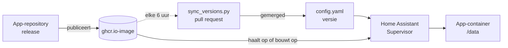

<div align="center">

<picture>
  <source media="(prefers-color-scheme: dark)" srcset=".github/assets/helmerznl.png">
  
</picture>

# Home Assistant Add-On Repository by Helmer

**De zelf te hosten apps van helmerzNL en Flux76, en de 3D-printtools Spoolman en HaspelSync, geïnstalleerd en bijgewerkt vanuit Home Assistant.**

Home Assistant-apps (add-ons) voor DiscVault, 3D Print Pricing, MealieShopper, Doorbell Map en NAS Storage Analyzer, en voor Spoolman en HaspelSync (gemaakt door anderen, hier verpakt), elk in een stabiele en een beta-versie. Elke app draait hetzelfde gepubliceerde image als de Docker-versie.

🇳🇱 **Nederlands** · 🇬🇧 [English](README.md)

[](#snel-starten)
[](#de-apps)
[](#wat-kan-het)

[](https://github.com/helmerzNL/home-assistant-addons/commits/main)
[](https://github.com/helmerzNL/home-assistant-addons/graphs/commit-activity)
[](https://github.com/helmerzNL/home-assistant-addons/forks)
[](https://github.com/helmerzNL/home-assistant-addons/stargazers)
[](https://github.com/helmerzNL/home-assistant-addons/issues)
[](https://github.com/helmerzNL/home-assistant-addons/graphs/contributors)

[](https://buymeacoffee.com/flux76)
[](https://ko-fi.com/flux76)

[](https://my.home-assistant.io/redirect/supervisor_add_addon_repository/?repository_url=https%3A%2F%2Fgithub.com%2FhelmerzNL%2Fhome-assistant-addons)

[Documentatie per app](#de-apps) · [Unraid-versie](https://github.com/helmerzNL/unraid-community-apps) · [Een fout melden](https://github.com/helmerzNL/home-assistant-addons/issues/new/choose)

<table>
  <tr>
    <td align="center" valign="top" width="20%"><a href="https://github.com/helmerzNL/DiscVault"><br><b>DiscVault</b></a><br><sub>Collectie van 4K UHD, Blu-ray en dvd</sub></td>
    <td align="center" valign="top" width="20%"><a href="https://github.com/Flux76HQ/3dprint_pricing"><br><b>3D Print Pricing</b></a><br><sub>Kostprijs en voorraad voor 3D-printen</sub></td>
    <td align="center" valign="top" width="20%"><a href="https://github.com/helmerzNL/MealieShopper"><br><b>MealieShopper</b></a><br><sub>Van weekmenu naar boodschappenmandje</sub></td>
    <td align="center" valign="top" width="20%"><a href="https://github.com/helmerzNL/Doorbell-Map"><br><b>Doorbell Map</b></a><br><sub>Wijkkaart voor deur-aan-deuracties</sub></td>
    <td align="center" valign="top" width="20%"><a href="https://github.com/helmerzNL/NAS-Storage-Analyzer"><br><b>NAS Storage Analyzer</b></a><br><sub>Opslaganalyse van je shares, alleen-lezen</sub></td>
  </tr>
  <tr>
    <td align="center" valign="top" width="20%"><a href="https://github.com/Donkie/Spoolman"><br><b>Spoolman</b></a><br><sub>Voorraad van je filamentspoelen (door Donkie)</sub></td>
    <td align="center" valign="top" width="20%"><a href="https://github.com/Rdiger-36/HaspelSync"><br><b>HaspelSync</b></a><br><sub>Bambu Lab-AMS gelijk met Spoolman (door Rdiger-36)</sub></td>
  </tr>
</table>

</div>

---

## Inhoud

- [Waarom Home Assistant Add-On Repository by Helmer?](#waarom-home-assistant-add-on-repository-by-helmer)
- [Wat kan het?](#wat-kan-het)
- [De apps](#de-apps)
- [Snel starten](#snel-starten)
- [Configuratie](#configuratie)
- [Beheer](#beheer)
- [Data en back-ups](#data-en-back-ups)
- [Architectuur](#architectuur)
- [Stabiel en beta](#stabiel-en-beta)
- [Meewerken](#meewerken)
- [Privacy en beveiliging](#privacy-en-beveiliging)
- [Steun Home Assistant Add-On Repository by Helmer](#steun-home-assistant-add-on-repository-by-helmer)
- [Licentie](#licentie)

## Waarom Home Assistant Add-On Repository by Helmer?

Elk van deze apps heeft een Docker Compose-bestand, maar als je server Home Assistant is, wil je daar liever geen Docker naast draaien. Deze
repository maakt van elk een Home Assistant-app: geïnstalleerd uit de app-store, ingesteld op het tabblad *Configuratie* in plaats van in een
`.env`-bestand, meegenomen in de back-ups van Home Assistant, en bijgewerkt zodra een nieuwe release van de app een gepubliceerd image heeft.
Elke app heeft ook een beta met eigen gegevens en een eigen poort, zodat je kunt proberen wat eraan komt zonder aan je stabiele installatie te
komen.

## Wat kan het?

- **Zeven apps in één repository**: DiscVault, 3D Print Pricing, MealieShopper, Doorbell Map en NAS Storage Analyzer, plus Spoolman en HaspelSync
  voor je 3D-printer, met één knop aan Home Assistant toegevoegd. Spoolman en HaspelSync zijn gemaakt door anderen; deze repository verpakt ze alleen.
- **Dezelfde app als de Docker-versie**: elke app draait het image dat de app zelf publiceert; DiscVault en NAS Storage Analyzer nemen hun eigen
  PostgreSQL mee in dezelfde container, dus er hoeft niets anders geïnstalleerd te worden.
- **Stabiel en beta naast elkaar**: elke beta heeft een eigen data-map en poort, zodat beide tegelijk draaien.
- **Updates zodra het image er is**: een controle elke 6 uur verhoogt de versie van een app pas als het image van de nieuwe release
  gepubliceerd is, dus Home Assistant biedt nooit een update aan die hij niet kan installeren.
- **In je Home Assistant-back-ups**: de gegevens van elke app staan in een eigen map, die Home Assistant met de app back-upt en terugzet.
- **Instellingen in het Engels en het Nederlands**: elke optie op het tabblad *Configuratie* is in beide talen uitgelegd, en elke app heeft een
  korte "Snel starten" en een tabblad *Documentatie*.
- **amd64 en aarch64**: elke app draait op beide.
- **Jij houdt de regie**: alles draait op je eigen Home Assistant, en de gegevens van elke app blijven daar in een eigen map.

## De apps

| App | Wat het doet | Poort | Database |
|---|---|---|---|
| [**DiscVault**](discvault/DOCS.md) | Beheer van je collectie 4K UHD, Blu-ray en dvd | 6180 | PostgreSQL, ingebouwd |
| [**DiscVault (beta)**](discvault-beta/DOCS.md) | De ontwikkelversie, naast de stabiele | 6181 | PostgreSQL, ingebouwd |
| [**MealieShopper**](mealieshopper/DOCS.md) | Van weekmenu in Mealie naar je boodschappenmandje | 5959 | SQLite |
| [**MealieShopper (beta)**](mealieshopper-beta/DOCS.md) | De ontwikkelversie, naast de stabiele | 5960 | SQLite |
| [**3D Print Pricing**](printpricing/DOCS.md) | Kostprijscalculator en voorraadbeheer voor een 3D-printbedrijf | 6080 | SQLite |
| [**3D Print Pricing (beta)**](printpricing-beta/DOCS.md) | De ontwikkelversie, naast de stabiele | 6081 | SQLite |
| [**Doorbell Map**](doorbell-map/DOCS.md) | Wijkkaart van huizen die wel of geen bezoek aan de deur willen | 9888 | bestanden |
| [**Doorbell Map (beta)**](doorbell-map-beta/DOCS.md) | De ontwikkelversie, naast de stabiele | 9889 | bestanden |
| [**NAS Storage Analyzer**](nas-storage-analyzer/DOCS.md) | Opslaganalyse van shares, netwerkopslag en NFS/SMB-servers, alleen-lezen | 6480 | PostgreSQL, ingebouwd |
| [**NAS Storage Analyzer (beta)**](nas-storage-analyzer-beta/DOCS.md) | De ontwikkelversie, naast de stabiele | 6481 | PostgreSQL, ingebouwd |
| [**Spoolman**](spoolman/DOCS.md) | Voorraad van je filamentspoelen voor de 3D-printer, door [Donkie](https://github.com/Donkie/Spoolman) | 7912 | SQLite |
| [**Spoolman (beta)**](spoolman-beta/DOCS.md) | De ontwikkelversie (`edge`), naast de stabiele | 7913 | SQLite |
| [**HaspelSync**](haspelsync/DOCS.md) | Houdt Spoolman gelijk met de AMS van een Bambu Lab-printer, door [Rdiger-36](https://github.com/Rdiger-36/HaspelSync) | 4000 | bestanden |
| [**HaspelSync (beta)**](haspelsync-beta/DOCS.md) | De ontwikkelversie (`dev`), naast de stabiele | 4001 | bestanden |

Elke app draait op amd64 en aarch64. De naam linkt naar de documentatie van de app, die Home Assistant ook op het tabblad *Documentatie*
toont; wat er per versie veranderde, staat in de `CHANGELOG.md` ernaast.

## Snel starten

### De repository toevoegen

1. Ga in Home Assistant naar **Instellingen > Apps > App installeren** (oudere versies: **Instellingen > Add-ons > Add-on store**).
2. Open het menu (⋮) > **Repositories** en voeg `https://github.com/helmerzNL/home-assistant-addons` toe (of druk op de knop bovenaan).
3. Kies een app uit [de lijst](#de-apps), **installeer** hem en lees het tabblad **Documentatie**. Elke app heeft ook een korte "Snel starten"
   op de eerste pagina.

### Eerste start

- **DiscVault**: vul op het tabblad *Configuratie* **rp_id** in (het domein waarop je DiscVault opent) of zet **password_login** aan. De
  eerste start duurt een minuut; open `https://<jouw domein>`, of `http://<ip>:6180` met wachtwoordinlog, en doorloop de onboarding.
- **3D Print Pricing**: vul eventueel eerst **rp_id** in. Start de app, lees de instelcode op het tabblad *Logboek*, open de app en doorloop
  de onboarding: instelcode, je naam, een passkey of een wachtwoord, en de herstelcodes.
- **MealieShopper**: start de app en open `http://<adres van Home Assistant>:5959` (of *Webinterface openen*); de installatie-assistent loopt je
  door de beveiliging en de koppelingen met Mealie en je supermarkten.
- **Doorbell Map**: vul **origin** in (het https-adres waarop je de kaart opent), start de app, lees de instelcode op het tabblad *Logboek*,
  open dan het origin-adres met `/beheer` erachter, vul de instelcode in en maak je passkey.
- **NAS Storage Analyzer**: start de app, lees de setup-token op het tabblad *Logboek*, open `http://<adres van Home Assistant>:6480` (of
  *Webinterface openen*), maak de beheerder met een wachtwoord en een authenticator-app, en voeg een share onder `/mnt/shares` toe.
- **Spoolman**: start de app en open `http://<adres van Home Assistant>:7912` (of *Webinterface openen*). Hij heeft geen eigen inlog, dus houd
  poort 7912 op je thuisnetwerk.
- **HaspelSync**: start de app en open `http://<adres van Home Assistant>:4000`; stel onder **Settings** een wachtwoord en het Spoolman-endpoint in
  (`http://<adres van Home Assistant>:7912` voor de Spoolman-app) en voeg je printers toe met serienummer, IP-adres en toegangscode.

DiscVault, 3D Print Pricing en Doorbell Map loggen in met **passkeys**. Die werken alleen op een **https**-adres met een domeinnaam: zet er een
reverse proxy met certificaat voor. 3D Print Pricing en (met de optie `password_login`) DiscVault accepteren ook een wachtwoord op een gewoon
lokaal adres. Spoolman heeft geen eigen inlog, en HaspelSync vraagt pas om een wachtwoord als je er een instelt.

## Configuratie

Alles stel je in op het tabblad *Configuratie* van de app; elke optie wordt daar en op het tabblad *Documentatie* uitgelegd. De geheimen die
in de `.env` van de Docker-versie zouden staan, worden bij de eerste start gemaakt en in de data-map van de app bewaard, dus die hoef je niet
zelf te verzinnen.

| App | Opties |
|---|---|
| DiscVault | Passkeys: `rp_id` (verplicht, tenzij `password_login` aanstaat; later wijzigen maakt bestaande passkeys onbruikbaar), `rp_origins`, `rp_name`. Inloggen met wachtwoord: `password_login`. OpenID Connect: `oidc_issuer`, `oidc_client_id`, `oidc_client_secret`, `oidc_provider_name`, `oidc_insecure_backchannel_origins`. Verder `trusted_proxies`, `omdb_api_key`, `tmdb_api_key` en `block_crawlers` (standaard aan) |
| 3D Print Pricing | Passkeys: `rp_id`, `rp_origins`. Verder `setup_code`, `proxy_hops`, `max_upload_mb`, `ai_images_enabled`, `spoolman_url`, `haspelsync_url`, `haspelsync_api_key` en `update_check` |
| MealieShopper | Alles optioneel, en een koppeling die je in de app maakt, gaat voor: `mealie_url`, `mealie_api_token`, `public_base_url`, `auth_secret`, `anthropic_api_key`, `openai_api_key`, `picnic_country_code`, `offers_schedule`, `offers_sync_hour`, `mcp`, `update_check`, `audit_log`, `audit_retention_days`, en voor passkeys `rp_id`, `rp_origins`, `rp_name` |
| Doorbell Map | `origin` (verplicht), `rp_id`, `site_title`, `setup_token`, `session_hours` |
| NAS Storage Analyzer | Alles optioneel: `setup_token`, `public_url`, voor passkeys `rp_id` en `rp_origins`, `trusted_proxies`, `worker_parallel`, `update_check`, en `encryption_key` alleen om een installatie te verhuizen |
| Spoolman | `automatic_backup` (standaard aan), `log_level`, `update_check` |
| HaspelSync | Geen: het Spoolman-endpoint, de printers en het wachtwoord stel je in in zijn webinterface |

## Beheer

| Taak | Hoe |
|---|---|
| Starten, stoppen, herstarten | De pagina van de app in Home Assistant |
| Bijwerken | Home Assistant biedt de update aan op de pagina van de app en onder *Updates*; laat hem eerst een back-up van de app maken |
| Terug naar de vorige versie | Zet de back-up van de app van voor de update terug (**Instellingen > Systeem > Back-ups**) |
| Logboek | Het tabblad *Logboek* van de app |

- **Health check:** met *Watchdog* aan herstart de Supervisor een app die niet meer antwoordt op zijn health-adres: `/api/next/health` voor
  DiscVault, `/healthz` voor 3D Print Pricing en MealieShopper, `/api/auth/status` voor Doorbell Map, `/readyz` voor NAS Storage Analyzer,
  `/api/v1/health` voor Spoolman en `/api/auth/state` voor HaspelSync.
- **Grootste upload:** 3D Print Pricing accepteert STL- en 3MF-bestanden tot `max_upload_mb` (standaard 50 MB, hoogstens 500). Wat voor een app
  staat (een reverse proxy, een CDN) moet minstens zoveel toelaten. De andere apps noemen hun grens in hun eigen documentatie.
- **Updatecheck:** 3D Print Pricing, MealieShopper, NAS Storage Analyzer en Spoolman kunnen de eigenaar ook in de app melden dat er een nieuwere release is (`update_check`);
  ze werken zichzelf nooit bij.

Sommige releases wijzigen de database, dus maak die back-up: een release die de database heeft gewijzigd, draait misschien niet op een oudere
versie.

### Hoe updates werken

Een update verschijnt in Home Assistant zodra `version` in de `config.yaml` van een app verandert. `scripts/sync_versions.py` vergelijkt die
versie met de nieuwste release van elke app en **verhoogt hem pas als het image van die release gepubliceerd is**. Elke 6 uur draait een
geplande Claude Code-taak het script op `main` en opent of werkt één pull request bij vanaf de branch `automation/update-versions` (de workflow
*Update add-on versions* doet hetzelfde met de hand). Merge die en Home Assistant biedt de update aan. In `sources.json` staat welke
repository, tag en welk image bij welke app horen.

Tot 3 november 2026 was `claude/tender-carson-9j0bgt` de standaardbranch van deze repository. Home Assistant blijft de branch lezen die de
standaard was toen de repository werd toegevoegd, en kan de repository niet verwijderen zolang er apps uit geïnstalleerd zijn. Daarom zet de
workflow *Keep the old default branch in step* die branch na elke merge op `main`, zodat een installatie van vóór de wissel dezelfde updates krijgt.

## Data en back-ups

De data-map van een app (`/data` erin) bevat alles:

| App | Wat erin staat |
|---|---|
| DiscVault | `postgres` (de database), `posters`, `profiles` en `backups`, en de gegenereerde geheimen in `secrets.json` |
| 3D Print Pricing | `db` (de database, één SQLite-bestand), `uploads` (de STL- en 3MF-bestanden) en de gegenereerde geheimen in `secrets.json`. De PostgreSQL-gegevens van een eerdere release in `postgres` worden maar één keer gelezen |
| MealieShopper | De database `auth.sqlite3` en `secret.key` |
| Doorbell Map | De huizen, passkeys, instellingen en de automatische back-ups van de app, en de gegenereerde geheimen in `secrets.json` |
| NAS Storage Analyzer | `postgres` (de database) en de gegenereerde encryptiesleutel in `encryption.key`, die de opgeslagen SMB-wachtwoorden versleutelt |
| Spoolman | `spoolman`: de database `spoolman.db`, de nachtelijke kopieën in `backups` en de logs |
| HaspelSync | `printers` (de printers, instellingen, vak-koppelingen en API-sleutels, als JSON-bestanden) en `logs` |

Home Assistant neemt die map mee in elke back-up van de app. Elke app behalve MealieShopper wordt daarbij even gestopt
(`backup: cold`), omdat een database waarin geschreven wordt geen consistente kopie is. Verwijder `secrets.json` niet: het
ondertekeningsgeheim van DiscVault beschermt ook de sleutels in zijn database. Zo kan NAS Storage Analyzer zijn opgeslagen SMB-wachtwoorden
niet lezen zonder `encryption.key`.

**Terugzetten** doe je onder **Instellingen > Systeem > Back-ups**. Om te **verhuizen** tussen Home Assistant en de Docker-installatie gebruik je
de eigen back-up en het terugzetten van de app (DiscVault: **Beheer → Backup**, ook volgens schema; 3D Print Pricing: *Instellingen → Systeem*;
MealieShopper: **Instellingen > Systeem > Back-up en terugzetten**; NAS Storage Analyzer: **Instellingen → Back-up**), of kopieer je bij Doorbell Map de data-map of gebruik je een back-up uit
het beheer. Bij Spoolman kopieer je `spoolman.db`, bij HaspelSync de bestanden van zijn map `printers`; hun documentatie zegt waar die in het
Docker-image staan.

## Architectuur



Er zijn twee soorten apps:

- **MealieShopper** noemt zijn image in `config.yaml`; de Supervisor haalt het kant-en-klare image `<image>:<versie>` op.
- **DiscVault, 3D Print Pricing, Doorbell Map en NAS Storage Analyzer** hebben een `Dockerfile` die op het app-image van die versie bouwt en een
  startscript toevoegt (`run.py`, `run.js`, `run.sh`). Het script maakt van de opties (`/data/options.json`) de variabelen van de `.env` van de Docker-installatie en maakt de
  geheimen één keer aan. DiscVault voegt PostgreSQL 17 toe en draait zijn database in dezelfde container; 3D Print Pricing heeft die alleen
  nodig voor de eenmalige import van een eerdere release. NAS Storage Analyzer bouwt op het all-in-one image van de app
  (`nas-storage-analyzer-aio`), waarin PostgreSQL 16, de webinterface en de scan-worker al zitten.
- **Spoolman en HaspelSync** hebben ook een `Dockerfile` op het app-image van die versie. Het `run.py` van Spoolman maakt van de opties zijn
  `SPOOLMAN_*`-variabelen en geeft zijn data-map aan de eigen gebruiker van het image; HaspelSync heeft geen opties en zet alleen zijn bestanden in `/data`.

| Onderdeel | Doel |
|---|---|
| `<app>/` | Eén app: `config.yaml`, `README.md` (de store-pagina), `DOCS.md`, `CHANGELOG.md`, `icon.png`, `logo.png`, `translations/` en, als hij bouwt, een `Dockerfile` en startscript |
| `<app>-beta/` | De beta van een app; gegenereerd uit de stabiele map, behalve die van MealieShopper |
| `repository.yaml` | De naam en maintainer die Home Assistant voor deze repository toont |
| `sources.json` | Per app: de repository, het tagpatroon en het image dat zijn versie volgt |
| `scripts/`, `tests/` | De controles, de beta-generator en de versiesynchronisatie |
| `.github/workflows/` | De CI bij elke pull request, de handmatige workflow *Update add-on versions*, en *Keep the old default branch in step* |

## Stabiel en beta

| | Stabiel | Beta |
|---|---|---|
| Map | `<app>` | `<app>-beta` |
| Image | de eigen versietag van de release | de meebewegende tag `beta` (Spoolman: `edge`, HaspelSync: `dev`; MealieShopper: zijn `-beta`-release) |
| Versie in Home Assistant | de release, bijvoorbeeld `1.0.30` | `<nieuwste release>-beta.<bouwtijd van het beta-image>`, bijvoorbeeld `1.0.30-beta.202610281205` |
| Poort | de poort van de app | één hoger |

Elke beta heeft een eigen data-map en poort, zodat hij naast de stabiele draait. Een beta is om nieuwe functies te proberen; gebruik de data
van de stabiele app niet voor een beta.

De beta-images van DiscVault, Doorbell Map, 3D Print Pricing en NAS Storage Analyzer hebben alleen een meebewegende `beta`-tag, en die van
Spoolman (`edge`, gebouwd vanaf zijn `master`-branch) en HaspelSync (`dev`, zijn `-dev`-releases) een eigen meebewegende tag, dus hun versie draagt
de bouwtijd van het beta-image: elke nieuwe beta-build geeft een hogere versie en een update, en de Supervisor bouwt de app dan opnieuw en haalt
dat image opnieuw op. Hun beta-mappen worden **gegenereerd** uit de stabiele mappen met `scripts/derive_beta.py`: pas de stabiele map aan en
draai het script (de CI faalt als een beta-map is afgedreven). MealieShopper publiceert zijn beta's als eigen releases, en zijn beta-map wordt
met de hand gelijk gehouden.

## Meewerken

Bijdragen zijn welkom. Pull requests gaan naar `main`. Voor fouten en ideeën over de apps in Home Assistant open je een
[issue](https://github.com/helmerzNL/home-assistant-addons/issues/new/choose); een probleem in een app zelf hoort in de repository van die app.

```bash
pip install pyyaml
python scripts/check_addons.py           # elke app compleet, vertaald (en/nl), gedocumenteerd in het Engels en Nederlands, geen poortconflicten
python -m unittest discover -s tests     # Python-tests
node --test tests/*.test.js              # startscript van Doorbell Map
python scripts/derive_beta.py --check    # beta-mappen kloppen met hun stabiele mappen (zonder --check: opnieuw maken)
python scripts/sync_versions.py --check  # welke versies verhoogd zouden worden
```

Een nieuwe app toevoegen: maak een map met `config.yaml`, `README.md` en `DOCS.md` (elk met een Engelse en een Nederlandse sectie en een
snelstart/installatie), `CHANGELOG.md`, `icon.png` (128 px), `logo.png` (256 px) en `translations/en.yaml` en `nl.yaml`; zet hem in
`sources.json` en in de lijsten van `.github/workflows/ci.yml`. `check_addons.py` meldt wat er nog ontbreekt. Een beta maak je door
`"channel": "beta"` en `"stable": "<map>"` in zijn regel in `sources.json` te zetten (en, als de meebewegende tag van de app niet `beta` is, die tag
als `"image_tag"` en de branch waarvan hij gebouwd wordt als `"branch"`) en `python scripts/derive_beta.py` te draaien.

## Privacy en beveiliging

- Alles draait op je eigen Home Assistant: geen account bij ons, geen analytics, geen tracking. Deze repository voegt niets toe dat contact
  maakt met wie dan ook; met wie een app verbinding maakt, staat in zijn eigen documentatie.
- De apps hebben geen ingress: elk heeft een eigen poort en een eigen inlog, behalve Spoolman, die er geen heeft, en HaspelSync, die pas om een
  wachtwoord vraagt als je er een instelt. Zet een poort niet rechtstreeks open naar internet; zet voor toegang van buitenaf een reverse proxy met
  https ervoor, en houd Spoolman op je thuisnetwerk.
- NAS Storage Analyzer vraagt de capabilities `SYS_ADMIN` en `DAC_READ_SEARCH` (die laatste voor SMB) en draait zonder AppArmor, omdat zijn
  scan-worker zelf NFS- en SMB-shares mount (alleen-lezen); het tabblad *Documentatie* legt uit waarom. De andere apps vragen geen extra
  rechten.
- Geheimen zijn wachtwoordvelden in het formulier, en de gegenereerde blijven in de data-map van de app; beide komen in je Home
  Assistant-back-ups terecht, dus bewaar die veilig.
- Meld een kwetsbaarheid vertrouwelijk via een [security advisory](https://github.com/helmerzNL/home-assistant-addons/security/advisories/new),
  nooit in een openbaar issue.

## Steun Home Assistant Add-On Repository by Helmer

De apps zijn gratis. Heb je er iets aan? Met een koffie houd je de ontwikkeling gaande.

<a href="https://buymeacoffee.com/flux76"></a>
<a href="https://ko-fi.com/flux76"></a>

## Licentie

Er is nog geen licentie gekozen voor deze repository: alle rechten voorbehouden. De apps die hij installeert, vallen hier niet onder; zie hun
eigen repositories.

---

<div align="center">
<sub>Met ❤️ gemaakt in Nederland door <a href="https://flux76.com">Flux76</a></sub>
</div>
